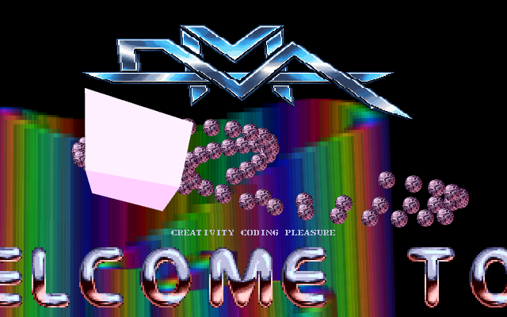
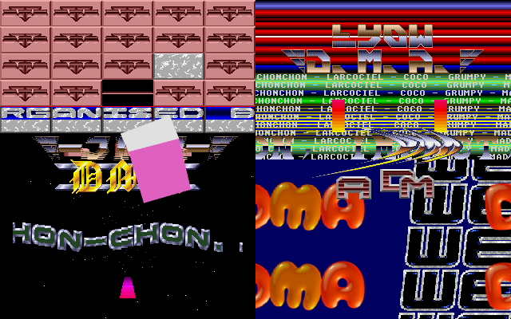
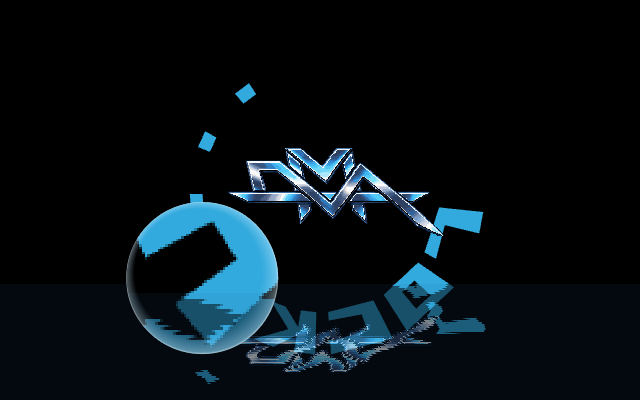
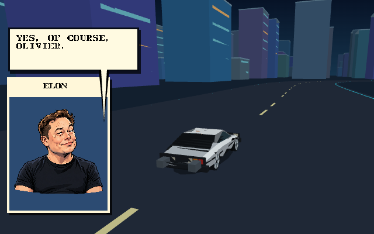

# DMA40 CODEF

DMA40 CODEF is a standalone HTML/JavaScript port of the complete **DMA40**
megademo. It recreates the 640×400 production on a deterministic 50 Hz timeline
with [CODEF](https://github.com/N0NameN0/CODEF), and runs directly in a modern
browser on desktop or mobile.



| Four live DMA screens | Circular scroll and lens |
| --- | --- |
|  |  |



## The production

The five-minute-thirty sequence retains the authored order and chapter timing
of the native production:

- the DMA40 opening and four historic DMA screens;
- vectorballs, the spoon and volumetric lattice flight;
- Matrix rain, the Bilizir reveal and Pac-Men;
- the circular scroll, water reflection, DMA logo and magnifying lens;
- the DeLorean city sequence and Elon exchange;
- Noname's DMA members, greetings and LATEAM pages;
- the DMA handoff, glass logo, checkerboard and point sphere;
- flocking, portrait formation, the audience question and the page of pi.

The visuals are rendered by JavaScript and Canvas through CODEF. This is a real
browser scene implementation rather than an embedded video. Lockbuster 3,
Raster Master and Chonchon reuse their existing source-derived CODEF engines;
DMA Is Back has its own new renderer. The opening, Spoon, city, Noname and Jelly
sections translate the Go controllers, meshes, trajectories, palettes and
timing data. The volumetric flight runs its original 128-sample shader through
WebGL 2 before CODEF composes the frame.

The packaged Opus track is the complete DMA40 soundtrack, synchronized to the
same 16,529-frame timeline. Prepared MOD spectrum data keeps the Noname
equalizer deterministic during playback, seeking and screenshots.

## Run

Open [index.html](index.html) directly. The project supports `file://`; no build,
package installation or local server is required.

An optional HTTP server can be started with:

```sh
python3 -m http.server 8080 --bind 127.0.0.1
```

Then open <http://127.0.0.1:8080/>.

Sound starts disabled because browsers require a user gesture. Click **Enable
sound** or press **M** to start the soundtrack at the current scene.

## Controls

| Action | Control |
| --- | --- |
| Enable or mute sound | **M** or the sound button |
| Pause or resume | **P**, **Escape** or the pause button |
| Advance one authored scene | **Space**, double-click, or **Next scene** |
| Restart | **R** or the restart button |
| Enter or leave fullscreen | Fullscreen button |

For deterministic review, query parameters select an exact starting point:

```text
index.html?time=181.54&paused=1
index.html?scene=noname&paused=1
```

The page exposes `window.dma40.renderAt(seconds)`, `advance(frames)` and
`snapshot()` for browser verification and screenshots.

## Project layout

| Path | Purpose |
| --- | --- |
| `index.html` | Standalone player and controls |
| `demo.js` | 50 Hz player, opening, loaders and scene composition |
| `timeline.js` | Exact chapters, major scenes and 50 Hz timing helpers |
| `effects/` | Source-derived Spoon, city, Noname and Jelly engines |
| `panels/` | Four-screen CODEF renderers and embedded file-safe assets |
| `assets/` | Graphics, motion data, palettes, portrait colors and soundtrack |
| `media/` | README and browser screenshots |
| `vendor/codef/` | Bundled CODEF core and upstream reference |
| `tests/` | Timeline, asset and implementation checks |

Run the checks with Node.js:

```sh
npm test
```

## DMA

DMA was founded in **1987**. DMA40 celebrates Aldo, Bilizir, Chonchon, Cigale,
Coco, Corwin, Dworkin, Grumpy, Jinx, Larcociel, Lockbuster, Mad, Mad Gillou,
Metalike, PDM and Twister.

> **French fries are good for you :)**

## Credits

DMA40 was conceived and coded by **Bilizir / DMA** in Go with Ebitengine and
Demo Construction Kit. This JavaScript adaptation uses **CODEF** by Antoine
Santo (N0NameN0) and contributors. Authorized artwork and music remain the
property of their respective authors. The bundled CODEF source retains its MIT
license header and upstream information.

The original source code in this adaptation is available under the MIT license.
Bundled artwork, music, names and production assets are excluded from that
license and remain the property of their respective authors.
